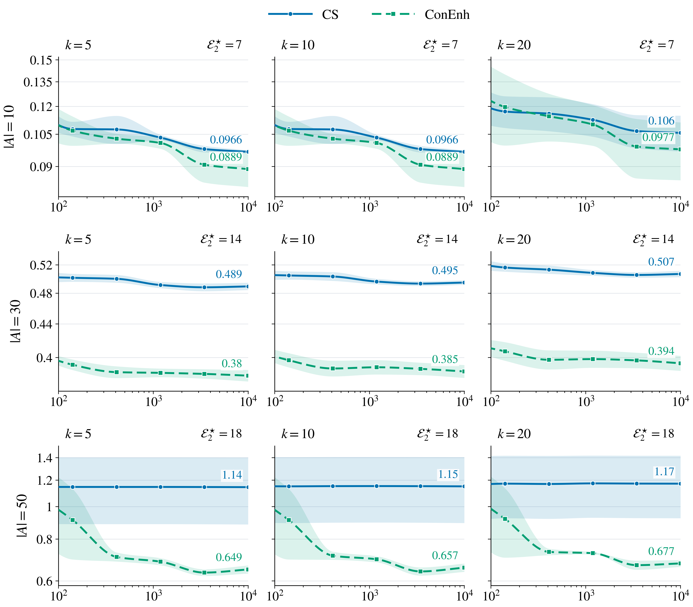
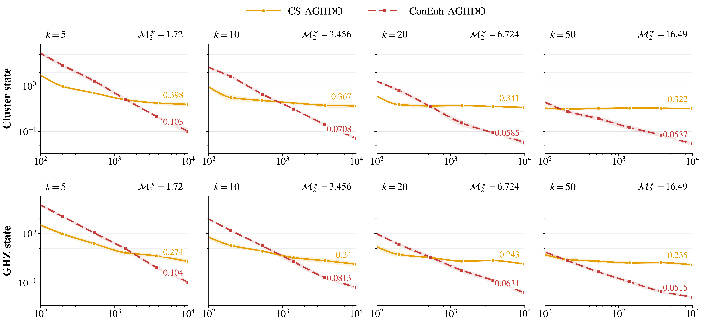

# Constraint-Enhanced Quantum Learning

Simulation pipeline for CS and ConEnh on locally rotated Cluster and GHZ states.  
Global magic estimation uses AGHDO in a known Clifford/product frame.

**Reference paper:**  
Matteo Tedde and Davide Girolami, *"A Few Reveal Many: Constraint-Enhanced Learning of Many-Body Quantum Systems"* (2026).  
[arXiv:2609.39935](https://arxiv.org/abs/2609.39935)

## Run

Python 3.9 or newer is required.

```bash
python -m pip install -e .
python simulations/run_simulations.py
```

Edit [simulations/config.txt](simulations/config.txt) to select the experiment.
`k_values` controls Figures 1 and 2; `magic_k_values` independently controls Figure 3.
Set `simulation.device` to `"cpu"` or `"cuda"` for the available hardware.
`plot.font_size`, `colors` and `magic_colors` control the presentation.

Compatible results in `simulations/cache/` are reused automatically; only missing
method/repetition results are computed. Figures and the execution manifest are
written to `simulations/output/`. Cache and generated output stay local.

Redraw exclusively from saved data:

```bash
python simulations/run_simulations.py --plot-only
```

## Verify

```bash
python simulations/run_simulations.py --dry-run
python simulations/run_simulations.py --smoke
python -m unittest discover -s tests
```

## Results

Curves show mean relative error over five realizations and bands show one standard
error of the mean.

**Figure 1. Bipartite 2-Renyi entanglement entropy.**



**Figure 3. Stabilizer 2-Renyi entropy (magic).**


